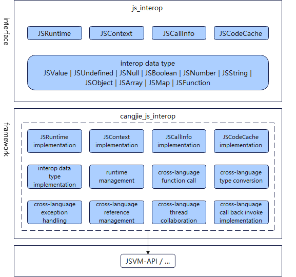

# Cangjie-JavaScript Interoperability
## Introduction

Cangjie-JavaScript interoperability is used to provide cross-language interoperability capabilities between Cangjie and JavaScript, namely Cangjie interoperability library interfaces. It aims to provide developers with cross-language interoperability solutions that balance development efficiency and runtime efficiency, offer a concise interoperability development paradigm, and reduce cross-language communication overhead. At the same time, this repository also provides public documentation, including Cangjie API reference and user manual. Currently, the interfaces open in this repository only support OpenHarmony scenario.

## System Architecture

The overall architecture is shown in the following diagram:



Interface Layer:

- Interoperability Library (ark_interop): Developers can achieve cross-language parameter passing, function calls, and other capabilities by calling the APIs provided by the interoperability library.
    - JSRuntime: Used to represent an JavaScript runtime instance. Each JavaScript runtime corresponds to one JSRuntime instance, which provides methods to create JSRuntime and obtain the execution context JSContext associated with that JSRuntime;
    - JSContext: Used to represent the execution context associated with a JSRuntime. This execution context saves global objects and provides methods for module loading, JSValue access, etc.;
    - JSCallInfo: Used to represent call information when JavaScript calls Cangjie methods, mainly used to obtain the number of parameters and parameter list;
    - JSCodeCache：Used to represent the cache of a piece of JavaScript code, mainly used to speed up the next compilation.
    - JSValue: Used to represent an JavaScript object. In Cangjie-JavaScript interoperability, it is used to encapsulate and pass JavaScript data objects. When you need to get values from JSValue on the Cangjie side, you need to use the methods provided in JSValue to convert them to specific type instances, such as JSNumber, JSString, JSBoolean, etc.; conversely, when you need to pass data from Cangjie side to JavaScript, you can use the methods provided by JSContext to encapsulate a Cangjie object into a JSValue instance;

Framework Layer:

- Runtime Management: Provides the ability to create JavaScript runtime.
- Cross-language Function Calls: In the Cangjie calling JavaScript scenario, JavaScript functions are called through C language interoperability with JavaScript runtime interfaces; in the JavaScript calling Cangjie scenario, Cangjie functions are registered to JavaScript runtime through interoperability interfaces, and then JavaScript runtime calls Cangjie functions through C language interoperability.
- Cross-language Type Conversion: The interoperability library mainly provides the following main types: JSUndefined, JSNull, JSBoolean, JSNumber, JSString, JSObject, JSArray, JSMap, JSFunction, etc., and provides interfaces to achieve mutual conversion between JavaScript types and Cangjie types. For the mapped Cangjie types, please refer to [Type Mapping](https://gitcode.com/Cangjie/cangjie_js_interop/blob/dev/doc/%E4%BB%93%E9%A2%89%E4%B8%8E%20JavaScript%20%E4%BA%92%E6%93%8D%E4%BD%9C%E5%BA%93%E7%94%A8%E6%88%B7%E6%89%8B%E5%86%8C.md#%E7%B1%BB%E5%9E%8B%E6%98%A0%E5%B0%84).
- Cross-language Exception Handling: In the Cangjie calling JavaScript scenario, when exceptions occur in JavaScript code but are not caught, the exception will be converted to a Cangjie exception and propagated to the Cangjie side; in the JavaScript calling Cangjie scenario, when exceptions occur in Cangjie code but are not caught, the exception will be converted to a JS exception and propagated to the JavaScript side.
- Cross-language Reference Management: Provides a safe reference mechanism. On the Cangjie side, Cangjie objects are used to map JavaScript runtime objects, ensuring that these JavaScript objects will not be garbage collected during cross-language calls.
- Cross-language Thread Coordination: Since Cangjie provides user-mode threads and the runtime schedules Cangjie threads to execute on system threads, Cangjie does not bind to specific system threads for execution by default. However, Cangjie-JavaScript interoperability logic requires running on the system thread bound to the JavaScript runtime, so the interoperability library provides interfaces to switch to JavaScript thread execution.

Dependent component introduction in the architecture diagram:
- JSVM-API: Provides the ability to call JavaScript virtual machine interfaces. The interoperability functionality is completed by calling the interfaces provided by JSVM through C language interoperability.

## Directory

```text
Cangjie/cangjie_js_interop
├── src         # Cangjie interoperability library
├── doc         # Library documentation
├── figures     # Images required for this README
```

## Usage Scenarios

In OpenHarmony application development, there is a demand for hybrid development using Cangjie and JavaScript, such as the following scenarios:

- Scenario 1: When developing with Cangjie, calling JavaScript libraries through cross-language interoperability to reuse the rich JavaScript library ecosystem;

For detailed examples, please refer to: [Using JavaScript Modules in Cangjie Applications](https://gitcode.com/openharmony-sig/arkcompiler_cangjie_ark_interop/blob/master/doc/cj-user-manual/source_en/FFI/cangjie-arkts/using_arkts_module.md)

- Scenario 2: When developing with JavaScript, calling code modules developed in Cangjie through cross-language interoperability to leverage Cangjie's high performance and high concurrency advantages, improving application performance experience; (Only support calling back Cangjie after Cangjie calling JavaScript for now)

For detailed examples, please refer to: [JavaScript Calling Cangjie](https://gitcode.com/Cangjie/cangjie_js_interop/blob/dev/doc/%E4%BB%93%E9%A2%89%E4%B8%8E%20JavaScript%20%E4%BA%92%E6%93%8D%E4%BD%9C%E5%BA%93%E7%94%A8%E6%88%B7%E6%89%8B%E5%86%8C.md#%E4%BB%93%E9%A2%89%E8%B0%83%E7%94%A8-javascript-%E5%90%8E%E5%9B%9E%E8%B0%83%E4%BB%93%E9%A2%89)

For interoperability related APIs, please see [API Documentation](https://gitcode.com/Cangjie/cangjie_js_interop/blob/dev/doc/%E4%BB%93%E9%A2%89%E4%B8%8E%20JavaScript%20%E4%BA%92%E6%93%8D%E4%BD%9C%E5%BA%93%20API%20%E6%96%87%E6%A1%A3.md), and for related guidance, please see [User manual](https://gitcode.com/Cangjie/cangjie_js_interop/blob/dev/doc/%E4%BB%93%E9%A2%89%E4%B8%8E%20JavaScript%20%E4%BA%92%E6%93%8D%E4%BD%9C%E5%BA%93%E7%94%A8%E6%88%B7%E6%89%8B%E5%86%8C.md)

## Constraints

None.

## Code Contribution

Developers are welcome to contribute code, documentation, etc. For specific contribution processes and methods, please refer to [Code Contribution](https://gitcode.com/openharmony/docs/blob/master/en/contribute/code-contribution.md).

## Related Repositories

[arkcompiler_jsvm](https://gitcode.com/openharmony/arkcompiler_jsvm)
