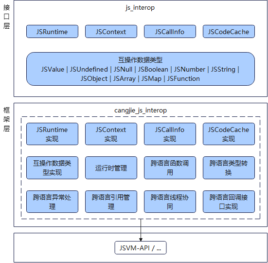

# 仓颉-JavaScript互操作

## 简介

仓颉-JavaScript互操作，用于提供仓颉与JavaScript跨语言互操作能力，即仓颉互操作库接口，期望给开发者提供兼顾开发效率和运行效率的跨语言互操作解决方案，提供简洁的互操作开发范式，降低跨语言互通开销。同时本仓还提供了公共文档，包含互操作库API参考和用户手册。当前本仓开放的接口仅支持鸿蒙场景。

## 系统架构

整体架构如下图所示：



接口层：

- 互操作库(js_interop)：开发者通过调用互操作库提供的API，实现跨语言参数传递、函数调用等能力。
    - JSRuntime：用于表示JavaScript运行时实例，每个JavaScript运行时对应一个JSRuntime实例，其提供创建JSRuntime的方法，以及获取与该JSRuntime关联的执行上下文JSContext；
    - JSContext：用于表示与一个JSRuntime关联的执行上下文，该执行上下文保存了全局对象，并提供模块加载、JSValue访问等相关方法；
    - JSCallInfo：用于表示JavaScript调用仓颉方法时的调用信息，主要用于获取参数数量和参数列表；
    - JSCodeCache：用于表示一段JavaScript代码的缓存，主要用于加速下次编译；
    - JSValue：用于表示一个JavaScript的对象，在仓颉与JavaScript互操作时，它用于封装和传递JavaScript数据对象，当在仓颉侧需要获取JSValue中的值时，需要使用JSValue中提供的方法将其转换为具体类型的实例，比如JSNumber、JSString、JSBoolean等；反之，当在仓颉侧需要把数据传递给JavaScript时，可以利用JSContext提供的方法将一个仓颉对象封装成JSValue实例；

框架层：

- 运行时管理：提供创建JavaScript运行时的能力。
- 跨语言函数调用：在仓颉调用JavaScript场景，通过C语言互操作JavaScript运行时接口实现调用JavaScript函数；在JavaScript调用仓颉场景，通过互操作接口注册仓颉函数到JavaScript运行时，然后JavaScript运行时通过C语言互操作调用仓颉函数。
- 跨语言类型转换：互操作库主要提供以下主要类型:JSUndefined，JSNull，JSBoolean，JSNumber，JSString，JSObject，JSArray，JSMap，JSFunction等，并提供接口实现JavaScript类型和仓颉类型的相互转换，其映射的仓颉类型请参考[类型映射](https://gitcode.com/Cangjie/cangjie_js_interop/blob/dev/doc/%E4%BB%93%E9%A2%89%E4%B8%8E%20JavaScript%20%E4%BA%92%E6%93%8D%E4%BD%9C%E5%BA%93%E7%94%A8%E6%88%B7%E6%89%8B%E5%86%8C.md#%E7%B1%BB%E5%9E%8B%E6%98%A0%E5%B0%84)。
- 跨语言异常处理：在仓颉调用JavaScript场景，JavaScript代码中出现异常而未捕获时，该异常会转换成一个仓颉异常并传播到仓颉侧；在JavaScript调用仓颉场景，仓颉代码中出现异常而未捕获时，该异常会转换成一个JS异常并传播到JavaScript侧。
- 跨语言引用管理：提供安全引用的机制，在仓颉侧使用仓颉对象来映射JavaScript运行时对象，保证这个JavaScript对象在跨语言调用时，不会被垃圾回收。
- 跨语言线程协同：由于仓颉提供用户态线程，运行时会将仓颉线程调度到系统线程上执行，因此仓颉默认不会绑定在特定系统线程执行，但是仓颉与JavaScript互操作逻辑要求运行在JavaScript运行时绑定的系统线程上，所以互操作库提供接口可以切换到JavaScript线程执行的能力。

架构图中依赖部件引入说明：
- JSVM-API：提供调用JavaScript虚拟机接口的能力，通过C语言互操作调用JSVM提供的接口完成互操作功能。

## 目录

```text
Cangjie/cangjie_js_interop
├── src         # 仓颉互操作库
├── doc         # 互操作库文档
├── figures     # 本README需要使用的图片
```

## 使用场景

在OpenHarmony应用开发中，存在使用仓颉与JavaScript混合开发的诉求，例如以下场景：

- 场景一：在使用仓颉开发时，通过跨语言互操作调用JavaScript库，复用JavaScript丰富的库生态；

详细的例子请参考：[仓颉应用中调用 JavaScript](https://gitcode.com/Cangjie/cangjie_js_interop/blob/dev/doc/%E4%BB%93%E9%A2%89%E4%B8%8E%20JavaScript%20%E4%BA%92%E6%93%8D%E4%BD%9C%E5%BA%93%E7%94%A8%E6%88%B7%E6%89%8B%E5%86%8C.md#%E4%BB%93%E9%A2%89%E5%BA%94%E7%94%A8%E4%B8%AD%E8%B0%83%E7%94%A8-javascript)

- 场景二：在使用JavaScript开发时，通过跨语言互操作调用仓颉开发的代码模块，发挥仓颉高性能高并发优势，提升应用性能体验；（目前只支持仓颉调用JavaScript后回调仓颉）

详细的例子请参考：[仓颉调用 JavaScript 后回调仓颉](https://gitcode.com/Cangjie/cangjie_js_interop/blob/dev/doc/%E4%BB%93%E9%A2%89%E4%B8%8E%20JavaScript%20%E4%BA%92%E6%93%8D%E4%BD%9C%E5%BA%93%E7%94%A8%E6%88%B7%E6%89%8B%E5%86%8C.md#%E4%BB%93%E9%A2%89%E8%B0%83%E7%94%A8-javascript-%E5%90%8E%E5%9B%9E%E8%B0%83%E4%BB%93%E9%A2%89)

互操作相关API请参见[API文档](https://gitcode.com/Cangjie/cangjie_js_interop/blob/dev/doc/%E4%BB%93%E9%A2%89%E4%B8%8E%20JavaScript%20%E4%BA%92%E6%93%8D%E4%BD%9C%E5%BA%93%20API%20%E6%96%87%E6%A1%A3.md)，相关指导请参见[用户手册](https://gitcode.com/Cangjie/cangjie_js_interop/blob/dev/doc/%E4%BB%93%E9%A2%89%E4%B8%8E%20JavaScript%20%E4%BA%92%E6%93%8D%E4%BD%9C%E5%BA%93%E7%94%A8%E6%88%B7%E6%89%8B%E5%86%8C.md)

## 约束

目前仅支持在 Linux 平台编译和使用，并且仅支持仓颉编译器的 cjnative 后端。

## 编译构建

### 构建准备

1. 开发者需要Linux平台的 `cangjie SDK`，然后，开发者需要执行对应 `SDK` 的 `envsetup` 脚本，确保 `SDK` 被正确配置。
2. 使用 `python` 构建脚本方式编译，请安装 `python3`。

### 构建步骤

1. 克隆本项目。

2. 通过 `build` 目录下的构建脚本编译仓颉-JavaScript互操作库：

    ```shell
    cd build
    python3 build.py build -t release
    ```

    当前支持 `debug`、`release` 两种编译类型，开发者需要通过 `-t` 或者 `--build-type` 指定。

3. 安装到指定目录：

    ```shell
    python3 build.py install
    ```

    默认安装到 `target` 目录下，支持开发者通过 `install` 命令的参数 `--prefix` 指定安装目录：

    ```shell
    python3 build.py install --prefix ./output
    ```

    编译产物目录结构为:

    ```text
    output/
    |-- js_interop.cjo                         # cjo文件
    |-- libjs_interop.so                       # 共享库文件
    ```

4. 清理编译中间产物：

   ```shell
   python3 build.py clean
   ```

### 更多构建选项

`build.py` 的 `build` 功能提供如下额外选项：
- `--target TARGET`: 指定编译目标产物的运行平台，默认值为 `native`，即本地平台，当前仅支持 `linux` 平台上编译；
- `-t, --build-type BUILD_TYPE`: 指定构建产物版本，可选值为 `debug/release`；
- `-h, --help`: 打印 `build` 功能的帮助信息。

此外，`build.py` 还提供如下额外功能：

- `install [--prefix PREFIX]`: 将构建产物安装到指定路径，不指定路径时默认为 `target/` 目录；`install` 前需要先正确执行 `build`；
- `clean`: 清除默认路径的构建产物；
- `-h, --help`: 打印 `build.py` 的帮助信息。

## 相关仓

[arkcompiler_jsvm](https://gitcode.com/openharmony/arkcompiler_jsvm)

## 开源协议

本项目基于 [Apache-2.0 with Runtime Library Exception](./LICENSE) 和 [Attribution 4.0 International](./doc/LICENSE)，请自由地享受和参与开源。

## 参与贡献

欢迎广大开发者贡献代码、文档等，具体的贡献流程和方式请参见[参与贡献](https://gitcode.com/Cangjie/CangjieCommunity/blob/main/contribute/contribution.md)。
