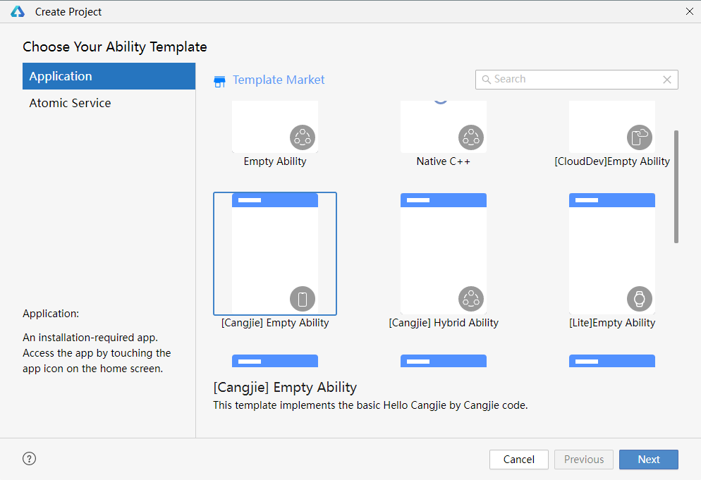
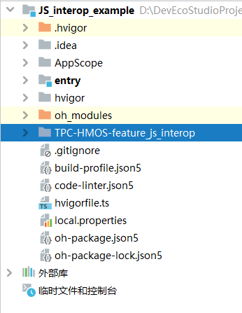
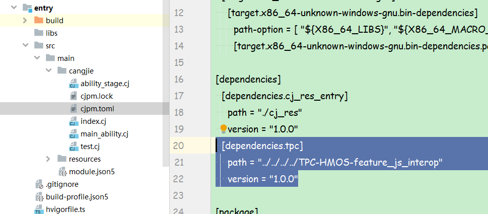
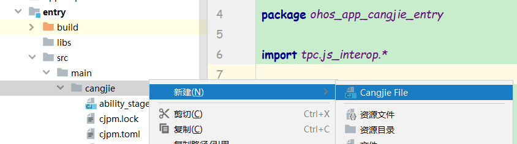
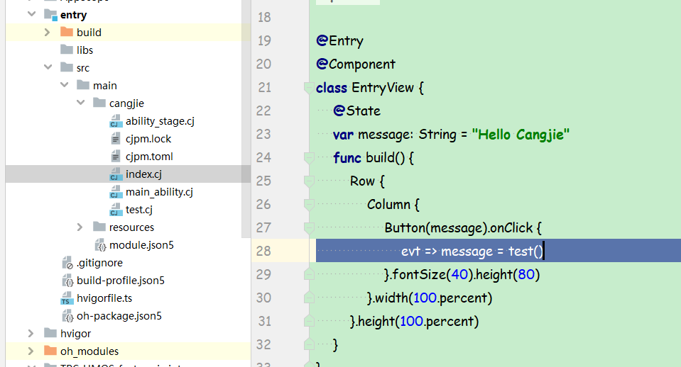

# 整体介绍

仓颉与 JavaScript 互操作库（以下简称互操作库）是一个仓颉的三方库，它提供了仓颉与 JavaScript 之间跨语言调用的能力。目前，它只支持从仓颉侧调用 JavaScript 以及 JavaScript 回调仓颉，且只支持在鸿蒙平台上使用。

## 使用方法

仓颉与 JavaScript 互操作库的使用流程如下：

1. 在仓颉代码中导入互操作库。
2. 通过互操作库提供的接口和 JavaScript 进行互操作，包括：

   > 创建 JavaScript 对象。
   >
   > 操作 JavaScript 对象。
   >
   > 执行 JavaScript 代码，并通过被调用的 JavaScript 代码回调仓颉函数。

## 快速上手

本节将通过例子详细介绍如何在 DevEco 中使用互操作库实现仓颉与 JavaScript 的互操作调用。

### 仓颉应用中调用 JavaScript

1. 创建仓颉工程。

   

2. 将互操作库代码复制到工程的顶层目录下。

   

3. 在 **src->main->cangjie->cjpm.toml** 文件中添加依赖。

   ```
   ...
     [dependencies.tpc]
       path = "../../../../TPC-HMOS-feature_js_interop"
       version = "1.0.0"
   ...
   ```

   

4. 在 **src->main->cangjie** 下新建仓颉文件，以 **test.cj** 为例。

   

5. 在 **test.cj** 文件中添加互操作代码，以如下代码为例，其中第 13~15 行即为被调用的 JS 代码。

   ```cangjie
   package ohos_app_cangjie_entry

   import js_interop.*

   func test() {
       // 创建JS运行时
       let runtime = JSRuntime.create()
       // 获取互操作上下文
       let context = runtime.mainContext
       context.newScope {
           // 加载JS代码到JS运行时
           context.evaluate('''
   function addNumber(a, b) {
       return a + b;
   }
   ''')
           // 获取加载至全局的JS函数
           let addNumber = context.global["addNumber"].asFunction()
           // 调用JS函数
           let result = addNumber.globalCall([1, 2])
           let retValue = result.toNumberInt64()
           return "1 + 2 = ${retValue}"
       }
   }
   ```

6. 修改 **src->main->cangjie->index.cj** 文件，使用 **test** 函数。

   ```
   ...
                       evt => message = test()
   ...
   ```

   

7. 编译运行后，点击按钮，会显示在 JS 侧计算的结果。

   

### 仓颉调用 JavaScript 后回调仓颉

1. 创建仓颉工程。

   

2. 将互操作库代码复制到工程的顶层目录下。

   

3. 在 **src->main->cangjie->cjpm.toml** 文件中添加依赖。

   ```
   ...
     [dependencies.tpc]
       path = "../../../../TPC-HMOS-feature_js_interop"
       version = "1.0.0"
   ...
   ```

   

4. 在 **src->main->cangjie** 下新建仓颉文件，以 **test.cj** 为例。

   

5. 在 **test.cj** 文件中添加互操作代码，以如下代码为例，其中第 14 行即为被调用的仓颉代码。

   ```cangjie
   package ohos_app_cangjie_entry

   import js_interop.*

   // 定义被调用接口
   func addNumber(context: JSContext, callInfo: JSCallInfo): JSValue {
       // 从JSCallInfo获取参数列表
       let arg0: JSValue = callInfo[0]
       let arg1: JSValue = callInfo[1]
       // 把JSValue转换为仓颉类型
       let a: Float64 = arg0.toNumberFloat64()
       let b: Float64 = arg1.toNumberFloat64()
       // 实际仓颉函数行为
       let value = a + b
       // 把结果转换为JSValue
       let result: JSValue = context.number(value).toJSValue()
       // 返回JSValue
       return result
   }

   func test() {
       // 创建JS运行时
       let runtime = JSRuntime.create()
       // 获取互操作上下文
       let context = runtime.mainContext
       context.newScope {
           // 注册到global即全局对象
           context.global["add"] = context.function(addNumber)
           // 从仓颉侧执行JS的调用代码
           let retValue = context.evaluate("add(1, 2)").toNumberInt64().toString()
           return "1 + 2 = ${retValue}"
       }
   }
   ```

6. 修改 **src->main->cangjie->index.cj** 文件，使用 **test** 函数。

   ```
   ...
                       evt => message = test()
   ...
   ```

   

7. 编译运行后，点击按钮，会显示在 JS 侧计算的结果。

   

# 规格介绍

## API 设计

详见仓颉与 JavaScript 互操作库 API 列表：[仓颉与 JavaScript 互操作库 API 文档](./仓颉与%20JavaScript%20互操作库%20API%20文档.md)。

## 类型映射

| JavaScript 类型 | 仓颉引用    | typeof 类型      | 支持情况 | API 列表                                                                                  |
| --------------- | ----------- | ---------------- | -------- | ----------------------------------------------------------------------------------------- |
| Undefined       | JSUndefined | JSType.UNDEFINED | 已支持   | [class JSUndefined](./仓颉与%20JavaScript%20互操作库%20API%20文档.md#class-jsundefined) |
| Null            | JSNull      | JSType.NULL      | 已支持   | [class JSNull](./仓颉与%20JavaScript%20互操作库%20API%20文档.md#class-jsnull)           |
| Boolean         | JSBoolean   | JSType.BOOLEAN   | 已支持   | [class JSBoolean](./仓颉与%20JavaScript%20互操作库%20API%20文档.md#class-jsboolean)     |
| Number          | JSNumber    | JSType.NUMBER    | 已支持   | [class JSNumber](./仓颉与%20JavaScript%20互操作库%20API%20文档.md#class-jsnumber)       |
| String          | JSString    | JSType.STRING    | 已支持   | [class JSString](./仓颉与%20JavaScript%20互操作库%20API%20文档.md#class-jsstring)         |
| Symbol          | -           | JSType.SYMBOL    | 暂不支持 | -                                                                                         |
| Object          | JSObject    | JSType.OBJECT    | 已支持   | [class JSObject](./仓颉与%20JavaScript%20互操作库%20API%20文档.md#class-jsobject)         |
| Array           | JSArray     | JSType.OBJECT    | 已支持   | [class JSArray](./仓颉与%20JavaScript%20互操作库%20API%20文档.md#class-jsarray)           |
| ArrayBuffer     | -           | JSType.OBJECT    | 暂不支持 | -                                                                                         |
| Date            | -           | JSType.OBJECT    | 暂不支持 | -                                                                                         |
| Map             | JSMap       | JSType.OBJECT    | 已支持   | [class JSMap](./仓颉与%20JavaScript%20互操作库%20API%20文档.md#class-jsmap)               |
| Set             | -           | JSType.OBJECT    | 暂不支持 | -                                                                                         |
| Promise         | -           | JSType.OBJECT    | 暂不支持 | -                                                                                         |
| RegExp          | -           | JSType.OBJECT    | 暂不支持 | -                                                                                         |
| Function        | JSFunction  | JSType.FUNCTION  | 已支持   | [class JSFunction](./仓颉与%20JavaScript%20互操作库%20API%20文档.md#class-jsfunction)     |
| Class           | -           | JSType.FUNCTION  | 暂不支持 | -                                                                                         |
| -               | -           | JSType.EXTERNAL  | 暂不支持 | -                                                                                         |
| BigInt          | -           | JSType.BIGINT    | 暂不支持 | -                                                                                         |

## 互操作类型的生命周期

对于 JavaScript 已支持的互操作类型，会有仓颉类型与之对应，这些仓颉类型的对象本质上是对 JavaScript 对象的引用。它们按引用方式的不同，生命周期也有区别，可以分为两类：

- 跨语言弱引用：持有 JavaScript 对象的弱引用，不会阻止 JavaScript 对象的回收，只在 scope 作用域内有效。对应的类型是 JSValue、JSUndefined、JSNull、JSBoolean、JSNumber。
- 跨语言强引用：持有 JavaScript 对象的强引用，会保证 JavaScript 对象不会被回收，可以跨 scope 作用域使用，在上下文存活期间有效。对应的类型是JSString、JSObject、JSArray、JSMap、JSFunction。这些强引用的类型统一继承自 `JSHeapObject` 从而进行生命周期管理，详见 [`interface JSHeapObject`](./仓颉与%20JavaScript%20互操作库%20API%20文档.md#class-jsheapobject)。

## 准备互操作环境

在准备好代码工程和实际进行互操作操作之间，还需要做一些固有的工作来准备互操作环境，步骤如下：

1. 通过 `JSRuntime` 的 `create` 函数创建一个 `JSRuntime` 实例，详见 [`static func create()`](./仓颉与%20JavaScript%20互操作库%20API%20文档.md#static-func-create)。
2. 通过 `JSRuntime` 实例的 `mainContext` 函数创建一个 `JSContext` 实例，详见 [`prop mainContext`](./仓颉与%20JavaScript%20互操作库%20API%20文档.md#prop-maincontext)。
3. 在 `JSContext` 实例的 `newScope` 函数内，通过 `JSContext` 实例的函数接口进行一系列的跨语言互操作，详见 [`func newScope<T>(() -> T)`](./仓颉与%20JavaScript%20互操作库%20API%20文档.md#func-newscopet---t) 和 [`class JSContext`](./仓颉与%20JavaScript%20互操作库%20API%20文档.md#class-jscontext)。

需要注意的是，不同的 `JSRuntime` 实例中数据是互相隔离的；在 `newScope` 函数内创建的跨语言弱引用是不能跨 scope 使用的，只有跨语言强引用可以，详见 [互操作类型的生命周期](#互操作类型的生命周期)。

## 创建 JavaScript 对象

上一节[准备互操作环境](#准备互操作环境)的步骤完成之后，可在 `newScope` 函数内通过 `JSContext` 实例的函数接口创建 JavaScript 对象，并得到引用它们的仓颉对象，详见 [`class JSContext`](./仓颉与%20JavaScript%20互操作库%20API%20文档.md#class-jscontext)。可创建的对象类型详见[类型映射](#类型映射)章节。

代码示例：

```cangjie
func test() {
    // 创建JS运行时
    let runtime = JSRuntime.create()
    // 获取互操作上下文
    let context = runtime.mainContext
    context.newScope {
        // 创建Number对象
        let v1 = context.number(Int32(1))
        let v2 = context.number(2.9)
        let v3 = context.number(UInt32(3))
        // 创建Array对象
        let array = context.array([v1, v2, v3, "s"])
        // 创建Object对象
        let object = context.object()
        // 创建Map对象
        let map = context.map<ToJSValue, ToJSValue>([(1, 1), (v2, 2), (object, "obj")])
    }
}
```

## 操作 JavaScript 对象

上一节[创建 JavaScript 对象](#创建-javascript-对象)的步骤完成之后，可通过互操作库操作创建出来的 JavaScript 对象。根据对象类型的不同，互操作库提供对应的操作能力，可操作的对象类型以及操作接口列表详见[类型映射](#类型映射)章节。


代码示例：

```cangjie
func test() {
    // 创建JS运行时
    let runtime = JSRuntime.create()
    // 获取互操作上下文
    let context = runtime.mainContext
    context.newScope {
        // 创建Number对象
        let v1 = context.number(Int32(1))
        let v2 = context.number(2.9)
        let v3 = context.number(UInt32(3))
        // 创建Array对象
        let array = context.array([v1, v2, v3, "s"])
        // 操作Array对象
        array[10] = 10
        array.deleteAt(0)
        // 创建Object对象
        let object = context.object()
        // 操作Object对象
        object[1] = context.number(1)
        // 创建Map对象
        let map = context.map([(1, 1), (v2, 2), (object, "obj")])
        // 操作Map对象
        map[1] = array
        map.deleteKey(1)
    }
}
```

## 执行 JavaScript 代码

章节[准备互操作环境](#准备互操作环境)的步骤完成之后，可在 `newScope` 函数内通过 `JSContext` 实例的的 `evaluate` 函数执行 JavaScript 代码，详见 [`func evaluate(String, JSCodeCache)`](./仓颉与%20JavaScript%20互操作库%20API%20文档.md#func-evaluatestring-jscodecache)。

`evaluate` 函数可接受任意的 JavaScript 代码进行解释执行，并将执行的返回值作为一个 `JSValue` 类型的变量返回，详见 [`struct JSValue`](./仓颉与%20JavaScript%20互操作库%20API%20文档.md#class-jsvalue)。执行过程中若出现 JavaScript 报错和异常，互操作库会将之转换为仓颉异常抛出。

`evaluate` 函数执行的代码中，如果存在全局变量的定义和函数的声明，这些全局变量和函数会被放入当前 `JSContext` 实例的全局对象中，可以在之后被使用。若执行的代码依赖其他代码或声明，需保证被依赖的数据已被执行或创建过。

调用 `evaluate` 函数时可选择性传入一段代码缓存，代码缓存可通过 [`func createCodeCache(String)`](./仓颉与%20JavaScript%20互操作库%20API%20文档.md#func-createcodecachestring) 函数创建。当传入代码和代码缓存校验一致时，将使用缓存来加速编译，否则直接编译代码。


代码示例：

```cangjie
func test() {
    // 创建JS运行时
    let runtime = JSRuntime.create()
    // 获取互操作上下文
    let context = runtime.mainContext
    context.newScope {
        // 创建console.log函数
        context.global["console"] = context.object([
            ("log", context.function { context, info =>
                let message = info.args[0].toString()
                Hilog.info(0, "console.log", message)
                context.undefined()
            })
        ])
        // 执行JS代码
        context.evaluate("console.log('hello, world!')")
        context.evaluate("console.log1('hello, world!')") // JS异常传播到仓颉抛出，log1不存在
    }
}
```

## JavaScript 代码回调仓颉

互操作库支持仓颉函数被 JavaScript 代码回调，步骤如下：

1. 声明被调用的仓颉函数，函数类型必须是 `(JSContext, JSCallInfo) -> JSValue`，其中 `JSCallInfo` 包含了 JavaScript 的调用信息。在函数的实现中，可通过 `JSCallInfo` 类型的入参获取 this 对象和参数列表，在执行完仓颉语句后，需要创建一个 `JSValue` 类型的变量返回。详见 [`struct JSCallInfo`](./仓颉与%20JavaScript%20互操作库%20API%20文档.md#struct-jscallinfo) 和 [`class JSValue`](./仓颉与%20JavaScript%20互操作库%20API%20文档.md#class-jsvalue)。
2. 完成章节[准备互操作环境](#准备互操作环境)的步骤。
4. 在 `JSContext` 实例的 `newScope` 函数内，通过一个 `JSObject` 实例（可以是全局对象或用户创建的对象）的 `[]` 函数将仓颉函数注册到 `JSContext` 实例中，详见 [`func newScope<T>(() -> T)`](./仓颉与%20JavaScript%20互操作库%20API%20文档.md#func-newscopet---t) 和 [`func [](JSKeyable, ToJSValue)`](./仓颉与%20JavaScript%20互操作库%20API%20文档.md#func-jskeyable-tojsvalue)。
5. 在 `JSContext` 实例的 `newScope` 函数内，可通过 `JSContext` 实例的 `evaluate` 函数调用注册的仓颉函数，详见 [`func newScope<T>(() -> T)`](./仓颉与%20JavaScript%20互操作库%20API%20文档.md#func-newscopet---t) 和 [`func evaluate(String, JSCodeCache)`](./仓颉与%20JavaScript%20互操作库%20API%20文档.md#func-evaluatestring-jscodecache)；或通过 `JSObject` 实例的 `[]` 函数获取 `JSValue` 类型的属性，再通过 `JSValue` 实例的 `asFunction` 函数转换为 `JSFunction` 实例，再通过 `JSFunction` 实例的 `call` 或 `globalCall` 函数来调用该函数，详见 [`class JSObject`](./仓颉与%20JavaScript%20互操作库%20API%20文档.md#class-jsobject)、 [`class JSValue`](./仓颉与%20JavaScript%20互操作库%20API%20文档.md#class-jsvalue)、 [`func asFunction()`](./仓颉与%20JavaScript%20互操作库%20API%20文档.md#func-asfunction)、 [`class JSFunction`](./仓颉与%20JavaScript%20互操作库%20API%20文档.md#class-jsfunction)、 [`func call<T>(ToJSValue, Array<T>)`](./仓颉与%20JavaScript%20互操作库%20API%20文档.md#func-callttojsvalue-arrayt-where-t--tojsvalue) 和 [`globalCall<T>(Array<T>)`](./仓颉与%20JavaScript%20互操作库%20API%20文档.md#func-globalcalltarrayt-where-t--tojsvalue)。

当被调用的仓颉函数发生异常时，该异常会被转换为 JavaScript 异常并抛到 JavaScript 运行时中，然后被转换为仓颉异常抛出。


代码示例：

```cangjie
// 定义被调用的仓颉函数
func addInt(context: JSContext, callInfo: JSCallInfo): JSValue {
    let augend = callInfo[0].toInt64()
    let addend = callInfo[1].toInt64()
    return context.number(augend + addend).toJSValue()
}

func test() {
    // 创建JS运行时
    let runtime = JSRuntime.create()
    // 获取互操作上下文
    let context = runtime.mainContext
    context.newScope {
        context.global["add"] = context.function(addInt)
        Hilog.info(0, "add", "1 + 2 = " + context.evaluate("add(1, 2)").toInt64().toString()) // 输出 1 + 2 = 3
        Hilog.info(0, "add", "1 + 2 = " + context.evaluate("add(1, '2')").toInt64().toString()) // 仓颉异常传播到JS再传播到仓颉抛出，参数类型错误
    }
}
```
